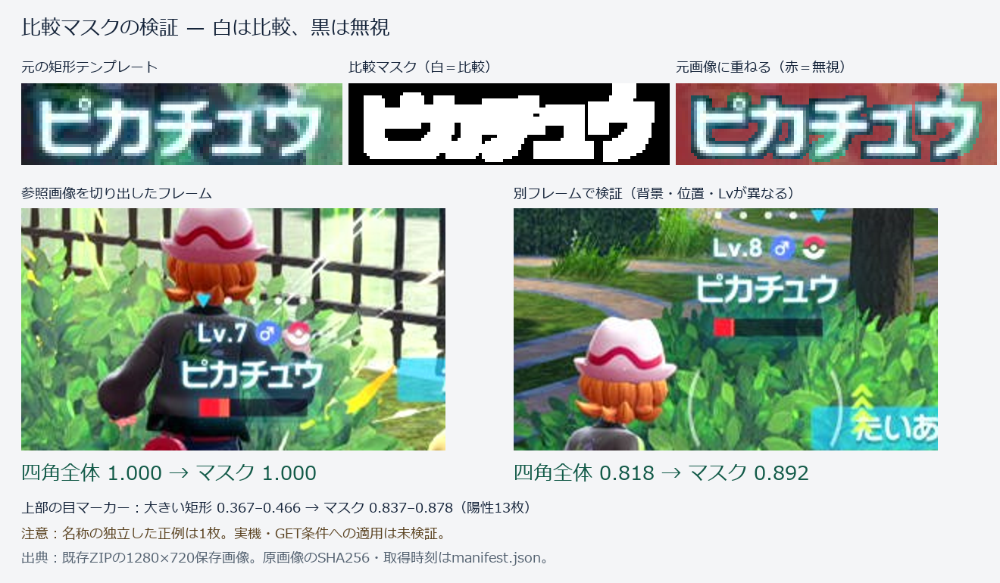

# 画像比較マスクの調査と任意機能 — 2026-10-26

この用途には効果があります。矩形画像と同じサイズの2値マスクを用意し、**白を比較、黒を無視**にします。元画像を黒く塗りつぶして通常比較する方法とは異なり、黒いマスクの位置は一致度の計算から外します。元画像・入力画像の色や明暗は残せます。



OpenCVの既存技術です。本PokeConの標準 `PythonCommandBase.isContainTemplate(mask_path=...)` にも実装があり、`ImageProcessing.py` はマスク指定時にNCCを使用します。一方、ZA Storyの生成済み `image_check()` は別経路の `LocalFunction.ImageDetection.detect_image()` を使っており、こちらには今回までマスク指定がありませんでした。[OpenCV公式のマスクの説明](https://docs.opencv.org/4.x/de/da9/tutorial_template_matching.html)、[照合方式・数式](https://docs.opencv.org/4.x/df/dfb/group__imgproc__object.html)

## 保存画像で確認した効果

既存の `D:/Recording/Switch_No3.zip` の1280×720原保存画像を使用しました。参照動画IDは `22Lc8za8OfQ`。元フレームのZIP内パス、時刻、SHA256、目視ラベルは [manifest.json](manifest.json)、一致度と位置は [results.json](results.json) に保存しています。元画像は無加工のJPEGバイトを `evidence/` に保持しています。

| 確認内容 | 四角全体のZNCC | マスクありZNCC | 解釈 |
|---|---:|---:|---|
| ピカチュウ名称、別フレーム454 | 0.8182 | 0.8925 | 同じ名前でも背景・位置・Lvが異なる例で改善 |
| ピカチュウ名称、参照元456 | 約1.000 | 約1.000 | 参照画像自身なので性能評価の正例数には含めない |
| 名称が対象位置にない14枚 | 最大0.4551 | 最大0.3805 | 今回の範囲では正例との分離が改善 |
| 上部の目、既存の大きいテンプレート、表示あり13枚 | 0.3669～0.4664 | 0.8367～0.8778 | 背景を含む帯を除外し、目と周囲のみにした効果 |
| 同じ目、表示なし／演出で隠れた3枚 | 最大0.2683 | 最大0.3692 | 仮の閾値0.8未満を維持 |

目の比較には既存 `eye_check_high.png`（299×30）を使用し、明るさ205以上の画素と周囲2pxを選びました。小さい従来 `eye_check.png`（19×12）も上記陽性13枚では0.649～0.726でした。ただし、個別の画像比較結果であり、既存Story全体のロックオン判定経路を実行した検証ではありません。

名称のマスクは保存456の `[610,375,716,402]` を切り出し、明るさ200以上と周囲2pxを選んだ下書きです。探索は `[250,210,930,500]`。左下の味方名称と右側の戦闘通知をできるだけ含めず、対象側の名称を探すための試験範囲です。この座標は全場面での固定解ではありません。

同動画に対応する原保存692枚も走査し、四角全体またはマスクで0.7以上の候補は454・456の2枚だけでした。両方の位置を目視し、対象側の「ピカチュウ」であることを確認しました。[走査結果](name_audit.json)、[再現用ZIPメンバー一覧](audit_manifest.json)。全不一致画像の正解ラベルは付けておらず、見逃し率や一般的な誤検知率の保証には使えません。連続動画の全フレーム検査でもありません。

## 白文字だけを残す場合の問題

ご指摘どおり、白文字の白い画素だけを選ぶと「文字の形を囲む暗い部分」が比較から消えます。合成した白文字と真っ白な画面では、通常のマスク付きNCCが**1.0**になることを再現しました。黒や灰色の一様な面でも正規化の性質に注意が必要です。

対策は、文字の縁・穴・周囲の背景を少し残すことです。下書きの「周囲2px」は文字を太く描く操作ではなく、元画像の比較範囲を広げる操作です。追加処理は選択画素だけの平均と分散を用いるZNCCとし、比較対象がほぼ単色の場合や非有限値を一致として扱いません。周囲付きマスクと白一色の比較は不一致（比較不能を示す `score=-2`）になりました。

近い別の名前、似た模様、解像度・拡大率の違い、文字の発光・ぼけ・遮蔽は別途検証が必要です。マスクにすると情報も減るので、細くしすぎれば識別力を落とします。マスクを付ければ必ず改善するわけではありません。[周囲を含める処理に用いたOpenCV dilation](https://docs.opencv.org/4.x/d9/d61/tutorial_py_morphological_ops.html)

## 追加したもの

- `LocalFunction/ImageDetection.py`：末尾に任意引数 `mask_path` を追加。未指定の比較と結果フィールドを維持。元画像とマスクのサイズ確認、同じ `template_crop`、既存crop／除外領域／履歴／表示／画像収集を保持。
- `LocalFunction/MaskedTemplate.py`：マスク作成・検証・選択画素のZNCC。OpenCVの通常CCORRを組み合わせ、旧版のマスク付きCCOEFF非対応やNaN/infを成功扱いする問題を避ける。空マスクや選択部分がほぼ単色の設定は明示エラー。
- `LocalFunction/TemplateMaskEditor.py`：元画像を下敷きに黒で除外、白で復元。拡大、筆幅、20回のUndo、明るい部分＋周囲の下書き、保存画像での一致位置確認、2値PNG保存。元画像・比較用画像への上書きを拒否。

利用手順と呼出し例は [LocalFunction README](../../SerialController/Commands/PythonCommands/LocalFunction/README.md#比較マスク2026-10-26任意指定)。プロジェクト直下から次でエディターを開けます。

```powershell
.\.venv314\Scripts\pythonw.exe SerialController\Commands\PythonCommands\LocalFunction\TemplateMaskEditor.py
```

動作には既存OpenCV・NumPy・Pillow・Tkを使用し、追加インストールは不要です。Python 3.7の構文検査も実施しています。試験環境の実ランタイムはPython 3.14.6／OpenCV 5.0.0です。

## 想定する3種のGET条件

今回の機能は任意指定の部品として追加しました。**既存の登録画像、DevStudio生成 `image_check()`、ZA StoryのGET条件には適用していません。** 起動中PokeConへのStop・Reload・再起動、カメラ取得、ゲーム入力も行っていません。

次に適用する場合の対象は、メリープ（`OUT_HOTEL_Z_20`）、ピカチュウ（`TOWER_36`）、4体目のコフキムシ（`OUT_HOTEL_Z_18`）です。デフォルトモードでは、対象名称が確認できないとGET処理を実行しない、というご希望を前提にします。

その際は「同じ新規フレームで捕獲可能表示と対象側の名称を確認する」「攻撃や時間待ちを挟んだら投球直前に再確認する」「別の名前・名前なし・入力欠測はGET禁止」「既に捕獲済みかは従来の手持ちアイコンで確認する」を分けて実装する必要があります。目マーカーだけでは種別が分かりません。右側通知・左下の味方名称を対象名称の代用にせず、補完モードの別条件がデフォルトの名称確認を迂回しないようにします。

今回の16枚にはメリープとコフキムシの対象側名称の正例がなく、ピカチュウも参照元を除く正例は1枚です。この状態で3種の名前判定とGET抑止を完成済みとはしません。今回保存したマスクは検証例で、製品のTemplate登録に自動投入していません。

マスク処理は比較に必要な計算が増えます。全体テストも動作中の参考計測で、名称ROIは四角全体約6ms／マスク約26ms、720p全画面は約29ms／約133msでした。時間は負荷に依存し、入力／表示FPSではありません。狭い探索範囲を使い、実機導入後は `CODEX_HANDOFF.md` の30秒継続・前面／背面・枠表示・入力切替復帰・入力／表示FPS確認が必要です。

## 再現と確認

```powershell
.\.venv314\Scripts\python.exe -B -m unittest tests.test_masked_template_detection tests.test_command_image_collection
.\.venv314\Scripts\python.exe -B reports/masked_template_20261026/reproduce.py
# 元ZIPがある場合のみ、692枚の走査も再実行
.\.venv314\Scripts\python.exe -B reports/masked_template_20261026/reproduce.py --audit-zip D:/Recording/Switch_No3.zip
```

新規15件＋既存画像収集19件の計34件成功。選択画素を直接計算する独立した数式との一致、白一色・別パターン、異常マスク、元画像保護、Unicodeパス、切出し・座標、fresh frame一回取得、入力欠測、従来API保持、手塗り・Undo・PNG往復を確認しました。エディターの操作検査は非表示Tkで行い、ユーザーの稼働PokeConには触れていません。

必須全体テストの結果と変更ファイルの検査記録は [verification.json](verification.json) に保存しました。最終878件／376.105秒は19 failures／8 errors／1 skipで、開始時の878件／338.620秒と診断27項目が一致（追加0・解消0）。全体成功とは扱いません。既存ImageDetectionの変更は`detect_image`のみで、他の関数・クラスのAST一致も確認しています。
